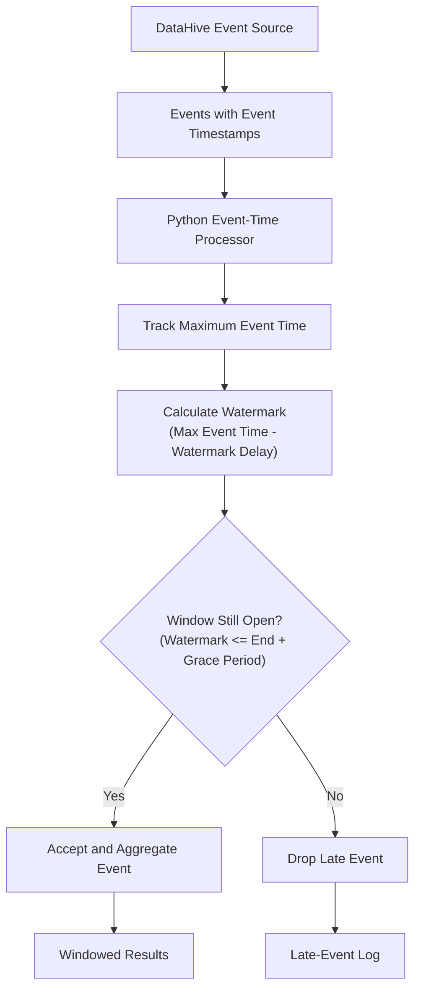
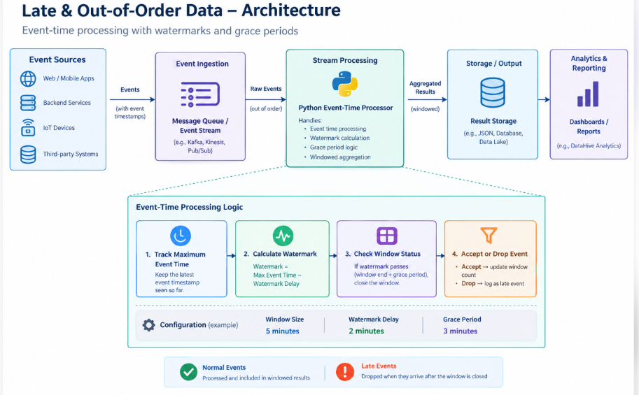

# Lab: Late & Out-of-Order Data

**Level:** Advanced  
**Type:** Standalone  
**Status:** Ready

## Introduction

DataHive receives user activity events from different devices and services. Sometimes, an event generated at 10:02 AM arrives after an event generated at 10:12 AM because of network delays or temporary disconnections. If the analytics pipeline processes events only in arrival order, its windowed results may become inaccurate. In this lab, you will build an event-time processing pipeline that uses watermarks and grace periods to handle out-of-order events and identify data that arrives too late.

### Architecture Diagram





## Project File Structure

Create the following project structure in your workspace:

```text
late-data-lab/
├── data/
│   └── events.json
├── src/
│   └── streaming.py
├── output/
│   └── summary.json
└── requirements.txt
```

The `data/` directory contains events in their simulated arrival order. The `src/` directory contains the event-time processing logic, while `output/` stores the aggregation results and late-event information. The `requirements.txt` file lists the dependencies required to run the project.

## Chapter 1 — Set Up the Workspace

Create a folder named `late-data-lab`. Inside it, create the `data`, `src`, and `output` folders, along with an empty `requirements.txt` file. 

Open your terminal, navigate to your workspace directory, and run:

**Linux / macOS:**
```bash
mkdir -p late-data-lab/data late-data-lab/src late-data-lab/output
touch late-data-lab/requirements.txt
cd late-data-lab
```

**Windows (PowerShell):**
```powershell
New-Item -ItemType Directory -Force -Path "late-data-lab/data", "late-data-lab/src", "late-data-lab/output"
New-Item -ItemType File -Force -Path "late-data-lab/requirements.txt"
Set-Location late-data-lab
```

This workspace separates input events, processing logic, and generated results. Keeping these components separate makes the pipeline easier to test and maintain.

## Chapter 2 — Prepare the Python Environment

In the terminal inside `late-data-lab`, set up and activate a virtual environment:

**Linux / macOS:**
```bash
python3 -m venv .venv
source .venv/bin/activate
```

**Windows (PowerShell):**
```powershell
python -m venv .venv
.venv\Scripts\Activate.ps1
```

**Windows (Command Prompt):**
```cmd
python -m venv .venv
.venv\Scripts\activate.bat
```

Open `requirements.txt` in the editor. This lab uses only Python's standard library (`json`, `collections`, `datetime`, `pathlib`), so no third-party packages are required. You can add a descriptive comment:

```text
# No third-party dependencies required (uses Python standard library)
```

The terminal prompt will display `(.venv)` when the virtual environment is active. You can now run the processing script using the isolated Python interpreter.

## Chapter 3 — Create the Event Dataset

Open `data/events.json` and add the following JSON array:

```json
[
  {
    "event_id": "e1",
    "user_id": "user_101",
    "event_time": "2026-10-18T10:01:00",
    "event": "login"
  },
  {
    "event_id": "e2",
    "user_id": "user_102",
    "event_time": "2026-10-18T10:04:00",
    "event": "purchase"
  },
  {
    "event_id": "e3",
    "user_id": "user_101",
    "event_time": "2026-10-18T10:03:00",
    "event": "click"
  },
  {
    "event_id": "e4",
    "user_id": "user_103",
    "event_time": "2026-10-18T10:12:00",
    "event": "purchase"
  },
  {
    "event_id": "e5",
    "user_id": "user_101",
    "event_time": "2026-10-18T10:02:00",
    "event": "click"
  }
]
```

The events are intentionally stored in **arrival order** rather than chronological order:
- Event `e3` arrives after `e2`, even though its event timestamp (`10:03:00`) is earlier than `e2` (`10:04:00`). This models an out-of-order event.
- Event `e5` (`10:02:00`) arrives after `e4` (`10:12:00`), after the processor has already observed a much later timestamp. This makes `e5` a candidate for late data rejection.

## Chapter 4 — Understand Event Time and Watermarks

Before implementing the processor, distinguish these three core concepts:

- **Event time:** The timestamp when the event actually occurred on the client device or upstream service.
- **Watermark:** The processor's metric indicating event-time progression. It is computed as:
  $$\text{Watermark} = \max(\text{Event Time seen so far}) - \text{Watermark Delay}$$
- **Grace period:** The additional tolerance window allowed for late events to reach an aggregation window before that window is finalized.

For this lab:
- **Window Size:** 5-minute tumbling windows (`10:00–10:05`, `10:05–10:10`, `10:10–10:15`)
- **Watermark Delay:** 2 minutes
- **Grace Period:** 3 minutes

### Window Finalization Rule
A window $[start, end)$ remains open to accept events until the watermark advances past the window end plus the grace period:
$$\text{Window Deadline} = end + \text{Grace Period} = (10:05) + 3\text{ min} = 10:08$$

If $\text{Watermark} > end + \text{Grace Period}$, the window is finalized. Any subsequent event targeting that window is categorized as **late data** and dropped.

## Chapter 5 — Implement the Event-Time Processor

Open `src/streaming.py` and implement the event-time processing logic:

```python
import json
from collections import defaultdict
from datetime import datetime, timedelta
from pathlib import Path

BASE_DIR = Path(__file__).resolve().parent.parent
INPUT_FILE = BASE_DIR / "data" / "events.json"
OUTPUT_FILE = BASE_DIR / "output" / "summary.json"

WINDOW_SIZE = timedelta(minutes=5)
WATERMARK_DELAY = timedelta(minutes=2)
GRACE_PERIOD = timedelta(minutes=3)


def parse_time(value):
    return datetime.fromisoformat(value)


def window_start(event_time):
    minute = (event_time.minute // 5) * 5
    return event_time.replace(minute=minute, second=0, microsecond=0)


def main():
    events = json.loads(INPUT_FILE.read_text())

    max_event_time = None
    counts = defaultdict(int)
    closed_windows = set()
    dropped_events = []

    for event in events:
        event_time = parse_time(event["event_time"])
        start = window_start(event_time)
        end = start + WINDOW_SIZE

        # Track the maximum event time observed so far.
        if max_event_time is None or event_time > max_event_time:
            max_event_time = event_time

        watermark = max_event_time - WATERMARK_DELAY

        # Finalize previously seen windows once the watermark passes
        # their end time plus the grace period.
        for window in list(counts):
            window_end = window + WINDOW_SIZE
            if watermark > window_end + GRACE_PERIOD:
                closed_windows.add(window)

        # Reject events targeting finalized windows.
        # A window is closed if the watermark has passed its end time plus the grace period.
        if watermark > end + GRACE_PERIOD or start in closed_windows:
            closed_windows.add(start)
            dropped_events.append({
                "event_id": event["event_id"],
                "event_time": event["event_time"],
                "reason": "Window closed"
            })
            print(f"DROPPED {event['event_id']}: window closed")
            continue

        counts[start] += 1

        print(
            f"ACCEPTED {event['event_id']} | "
            f"event_time={event['event_time']} | "
            f"watermark={watermark.isoformat()}"
        )

    # Ensure output directory exists before writing results.
    OUTPUT_FILE.parent.mkdir(parents=True, exist_ok=True)

    # Finalize remaining windows at the end of this finite input.
    summary = {
        "window_counts": [
            {
                "window_start": start.isoformat(),
                "window_end": (start + WINDOW_SIZE).isoformat(),
                "count": count
            }
            for start, count in sorted(counts.items())
        ],
        "dropped_events": dropped_events,
        "total_dropped": len(dropped_events)
    }

    OUTPUT_FILE.write_text(json.dumps(summary, indent=2))
    print(f"\nResults saved to {OUTPUT_FILE}")


if __name__ == "__main__":
    main()
```

### Key Logic Explanations:
1. **Window Alignment:** `window_start()` calculates the lower boundary of the 5-minute tumbling window (e.g., `10:03` maps to `10:00`).
2. **Watermark Progression:** Each new max timestamp advances `watermark` (`max_event_time - 2 min`).
3. **Robust Window Closure:** The condition `watermark > end + GRACE_PERIOD` ensures that **any** event arriving past its grace deadline is dropped, even if the window had no prior events recorded.
4. **Resilient Output:** `OUTPUT_FILE.parent.mkdir(parents=True, exist_ok=True)` prevents `FileNotFoundError` if the output folder was not created beforehand.

## Chapter 6 — Run the Pipeline

In the terminal inside `late-data-lab`, execute:

```bash
python src/streaming.py
```

### Expected Terminal Output:

```text
ACCEPTED e1 | event_time=2026-10-18T10:01:00 | watermark=2026-10-18T09:59:00
ACCEPTED e2 | event_time=2026-10-18T10:04:00 | watermark=2026-10-18T10:02:00
ACCEPTED e3 | event_time=2026-10-18T10:03:00 | watermark=2026-10-18T10:02:00
ACCEPTED e4 | event_time=2026-10-18T10:12:00 | watermark=2026-10-18T10:10:00
DROPPED e5: window closed

Results saved to late-data-lab/output/summary.json
```

### Event Trace Analysis:
- `e1`, `e2`: Arrive in order and are accepted into the `10:00–10:05` window.
- `e3` (`10:03`): Arrives out of order after `e2` (`10:04`), but because the watermark is at `10:02` (which has not passed `10:08`), the window is still open. `e3` is accepted.
- `e4` (`10:12`): Advances `max_event_time` to `10:12`, moving the watermark to `10:10`. The `10:00–10:05` window deadline (`10:05 + 3m = 10:08`) has now passed, finalizing the window.
- `e5` (`10:02`): Targets the `10:00–10:05` window. Since watermark `10:10` exceeds the window deadline `10:08`, `e5` is dropped as late data.

## Chapter 7 — Inspect the Results

Open `output/summary.json`. The output contains window aggregates and details of dropped events:

```json
{
  "window_counts": [
    {
      "window_start": "2026-10-18T10:00:00",
      "window_end": "2026-10-18T10:05:00",
      "count": 3
    },
    {
      "window_start": "2026-10-18T10:10:00",
      "window_end": "2026-10-18T10:15:00",
      "count": 1
    }
  ],
  "dropped_events": [
    {
      "event_id": "e5",
      "event_time": "2026-10-18T10:02:00",
      "reason": "Window closed"
    }
  ],
  "total_dropped": 1
}
```

The first window includes three events (`e1`, `e2`, and the out-of-order event `e3`). Event `e5` was successfully identified and logged in `dropped_events`.

## Chapter 8 — Experiment with the Grace Period

To observe how tuning the grace period impacts late data tolerance, edit `GRACE_PERIOD` in `src/streaming.py` from 3 minutes to 10 minutes:

```python
GRACE_PERIOD = timedelta(minutes=10)
```

Run the processor again:

```bash
python src/streaming.py
```

### Updated Terminal Output:

```text
ACCEPTED e1 | event_time=2026-10-18T10:01:00 | watermark=2026-10-18T09:59:00
ACCEPTED e2 | event_time=2026-10-18T10:04:00 | watermark=2026-10-18T10:02:00
ACCEPTED e3 | event_time=2026-10-18T10:03:00 | watermark=2026-10-18T10:02:00
ACCEPTED e4 | event_time=2026-10-18T10:12:00 | watermark=2026-10-18T10:10:00
ACCEPTED e5 | event_time=2026-10-18T10:02:00 | watermark=2026-10-18T10:10:00

Results saved to late-data-lab/output/summary.json
```

### Inspect the Updated Results:

Open `output/summary.json`:

```json
{
  "window_counts": [
    {
      "window_start": "2026-10-18T10:00:00",
      "window_end": "2026-10-18T10:05:00",
      "count": 4
    },
    {
      "window_start": "2026-10-18T10:10:00",
      "window_end": "2026-10-18T10:15:00",
      "count": 1
    }
  ],
  "dropped_events": [],
  "total_dropped": 0
}
```

With `GRACE_PERIOD = 10 minutes`, the `10:00–10:05` window remains open until:
$$\text{Deadline} = 10:05 + 10\text{ min} = 10:15$$

Since the watermark at `e4` is `10:10` (which is $\le 10:15$), the window is still open. Event `e5` is accepted, increasing the first window's count from 3 to 4.

> [!TIP]
> After completing this experiment, restore `GRACE_PERIOD = timedelta(minutes=3)` if you want to keep the standard baseline configuration.

## Conclusion

In this lab, you built an event-time processing pipeline that reliably handles out-of-order events using watermarks and grace periods. You learned:
1. How watermarks advance based on maximum event time minus watermark delay.
2. How out-of-order events arriving before the grace period deadline are correctly accepted.
3. How events arriving after the deadline are dropped and recorded in a late-event audit log.
4. The engineering trade-off between longer grace periods (higher data completeness) and shorter grace periods (faster result finalization and reduced state retention).